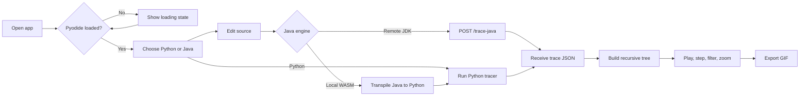

# Recursion Tree Visualizer

Live demo https://treevisualizer.onrender.com/

> A calm, visual way to understand what recursive code is actually doing.

Recursion Tree Visualizer turns a recursive Python or Java function into an interactive call tree. Run the example, move through each call and return, filter the arguments shown on nodes, zoom around large trees, and export the playback as a GIF.

The project started as a small React/Vite experiment and grew into a browser-based learning tool with two execution paths for Java. It is intentionally practical: the tree does the explaining, so the interface keeps the surrounding noise low. The occasional questionable commit and the “I’ll just add one more language” detour are part of the development story.

## Current state

The current UI is a responsive, light-first workspace styled as a polished pale-lavender evening:

- Main background: `#F7F4FA` (Lavender Mist)
- Alternate surfaces: `#F0EBF6`
- Cards: `#FFFFFF`
- Soft surfaces: `#E9E1F2`
- Accents: `#C9B9DF`
- Interactive controls: `#8B78B8`
- Primary text: `#49365E`
- Secondary text: `#766A83`
- Borders: `#E5DFEC`

The code editor stays dark because syntax highlighting and long code blocks remain easier to read there. The application shell, tree, controls, status panels, empty state, and responsive behavior use the light lavender palette. Decorative details are deliberately restrained: small stars, a moon mark, and a soft dotted canvas rather than a large illustration or a saturated gradient.

## What is built

### 1. React/Vite application shell

- `src/main.jsx` mounts the React application.
- `src/App.jsx` owns the interactive state and composes the editor, execution controls, playback controls, and tree view.
- Vite provides the development server and production bundling.
- The UI is responsive: the editor and visualizer sit side by side on wide screens and stack on smaller screens.

### 2. Python tracing in the browser

Python execution is handled by Pyodide, loaded from the CDN in `index.html`. The app injects the user’s Python source into a small tracing script that uses `sys.settrace`.

The tracer:

1. Records every function call.
2. Captures argument names and values.
3. Creates a node for each call.
4. Connects child calls to their parent.
5. Records return values.
6. Produces a JSON payload containing `steps` and a root `tree`.

This makes the Python path local to the browser after the Pyodide runtime is available. No Python server is required for the default path.

### 3. Java support

Java has two execution modes:

#### Local WASM/transpilation mode

`src/javaTranspiler.js` converts a supported Java subset to Python. It handles common recursive examples including:

- Static method signatures
- `if`, `else if`, and `else`
- Braced and braceless blocks
- Typed variable declarations
- Return statements
- `&&`, `||`, `!`, `==`, and `!=`
- `true`, `false`, and `null`
- Common `Math` methods
- Basic arrays and `.length`
- Common `System.out` calls

The generated Python is shown in an editable “Transpiled Python” panel. This is useful both for learning and for correcting a translation before running it through the same Pyodide tracer used by Python.

#### Remote JDK mode

The optional Express server in `server/index.js` exposes `POST /trace-java`. It:

1. Receives Java source as JSON.
2. Instruments supported method entries and return statements.
3. Writes temporary `Tracer.java` and user source files.
4. Compiles them with `javac`.
5. Runs the generated class with the installed JDK.
6. Extracts the JSON between `---JSON_START---` and `---JSON_END---`.
7. Returns the same `steps`/`tree` shape to the React app.

This path executes real Java, so it requires a local JDK and the backend process.

### 4. Interactive tree and playback

Once a trace is returned, the visualizer supports:

- Previous, play/pause, next, and reset controls
- Slow, normal, and fast playback speeds
- Active-call highlighting
- Returned-node highlighting and result labels
- Rectangle or circle node shapes
- Argument visibility toggles
- Zoom in, zoom out, reset zoom, and Ctrl/trackpad zoom
- Empty and error states

The tree is rendered recursively by `TreeNode`, while CSS pseudo-elements draw the parent/child connectors.

### 5. GIF export

The GIF action walks through every recorded step, captures the tree with `html-to-image`, and assembles the frames using `gif.js`. The result downloads as `recursion-tree.gif`.

The export temporarily resets zoom so the full tree is captured, then restores the user’s zoom and active step when rendering finishes.

### 6. Syntax highlighting and editing

- `react-simple-code-editor` provides the editable source surface.
- Prism grammars are loaded for Python and Java.
- The selected language controls both the default sample and highlighting grammar.
- Switching languages resets the trace state and loads the matching Fibonacci sample.

## User flow



## Trace data shape

The browser and backend paths converge on the same conceptual payload:

```json
{
  "steps": [
    {
      "type": "CALL",
      "nodeId": 0,
      "funcName": "fib",
      "args": { "n": "4" },
      "parentId": null
    },
    {
      "type": "RETURN",
      "nodeId": 0,
      "label": "fib returned 3",
      "value": 3
    }
  ],
  "tree": {
    "id": 0,
    "funcName": "fib",
    "args": { "n": "4" },
    "value": 3,
    "children": []
  }
}
```

`steps` drives playback. `tree` drives the recursive layout. A missing tree is reported as “No recursion detected” because there is no useful visual trace to display.

## Project structure

```text
.
├── index.html                 # HTML entry point and Pyodide loader
├── package.json               # Scripts and runtime dependencies
├── vite.config.js             # Vite configuration
├── eslint.config.js           # ESLint configuration
├── public/
│   ├── favicon.svg            # Application icon
│   ├── gif.worker.js          # gif.js worker
│   └── icons.svg              # Static icon assets
├── server/
│   ├── index.js               # Optional Java/JDK tracing API
│   └── package.json           # Backend package metadata
└── src/
    ├── App.jsx                # UI, state, tracing orchestration, playback
    ├── App.css                # Lavender Mist visual system and tree layout
    ├── index.css              # Global document sizing/background
    ├── javaTranspiler.js       # Java subset to Python conversion
    ├── main.jsx                # React bootstrap
    └── assets/                 # Starter and hero assets
```

## Getting started

### Requirements

- Node.js 18+ recommended
- npm
- Internet access on first load so the browser can fetch Pyodide
- Optional: a JDK with `javac` and `java` on `PATH` for Remote JDK mode

### Install

```bash
npm install
```

### Run the frontend

```bash
npm run dev
```

Open the URL Vite prints, usually `http://localhost:5173`.

### Run the optional Java backend

In another terminal:

```bash
npm run server
```

The backend listens on `http://localhost:5001`. Select **Java → Remote (JDK)** in the app to use it.

### Run both processes

```bash
npm run dev:all
```

### Build and lint

```bash
npm run build
npm run lint
```

## Known boundaries

- Pyodide is loaded from a CDN, so the local Python path depends on network access and browser WebAssembly support.
- The Java transpiler intentionally supports a useful recursive subset, not the entire Java language.
- Remote Java tracing requires a JDK and uses temporary files under `server/`.
- The remote instrumentation is designed for educational examples and simple method layouts; complex overloads, unusual formatting, or advanced Java constructs may need adaptation.
- The app expects the final executable call to be present in Python or in Java’s `main`.
- GIF rendering is CPU and memory intensive for very large trees.
- There are no automated unit tests in the current repository; build and lint are the available regression checks.

## Design principles

1. **Show the mechanics.** Calls and returns are easier to understand when they are visible.
2. **Keep the palette quiet.** Lavender is used as atmosphere, not as visual noise.
3. **Make learning reversible.** Step backward, reset, edit, and rerun without losing context.
4. **Prefer readable engineering over spectacle.** The anime-inspired cues are small; the trace stays in charge.
5. **Leave room for the next questionable idea.** Recursive code has a habit of growing beyond the original scope. The interface should still make that growth legible.
